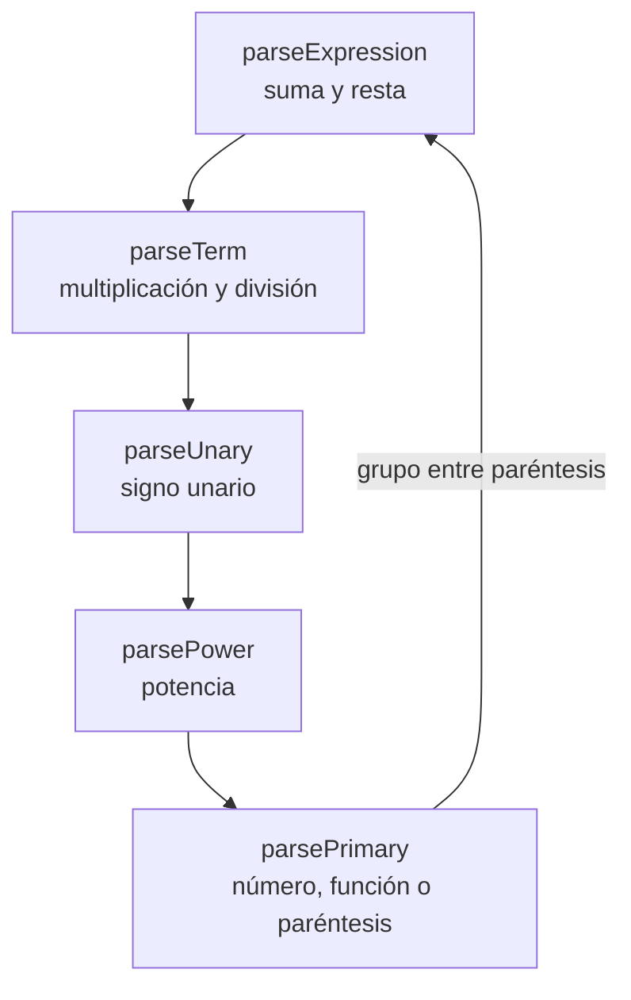
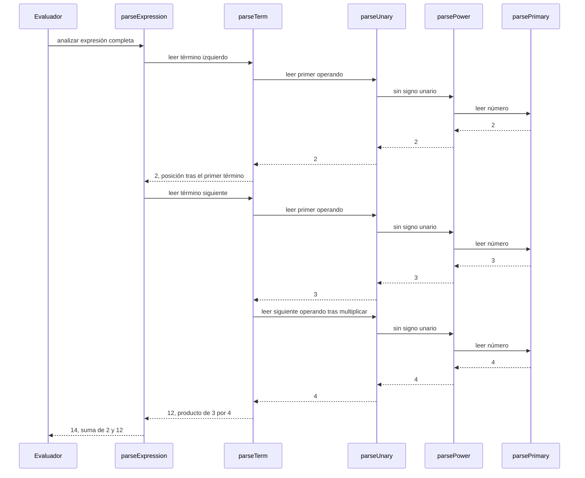
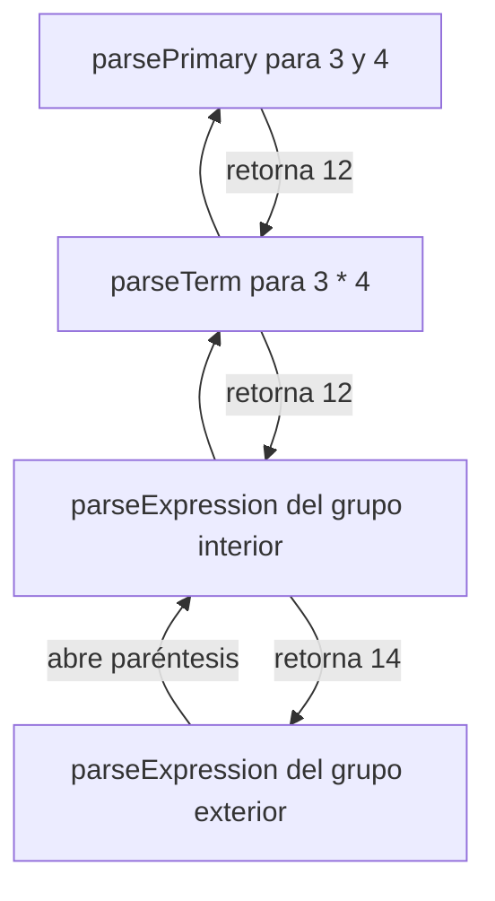

# Cómo funciona el motor de expresiones de Calc2

Calc2 recibe una expresión escrita en notación infija, como `2 + 3 * 4`, y devuelve su
resultado numérico. El motor no transforma primero la expresión a notación postfija ni
construye un árbol de sintaxis. La analiza y la evalúa directamente mediante **descenso
recursivo**, una técnica que permite relacionar la gramática de una expresión con llamadas a
métodos.

Este diseño sirve para estudiar varios temas de estructuras de datos: tipos abstractos de
datos, estado y operaciones, recursividad y la pila de llamadas. También permite distinguir
entre una estructura usada explícitamente por el programa y una que forma parte del entorno de
ejecución de Java.

## De la cadena al resultado

La entrada es una cadena de caracteres. El evaluador conserva esa cadena y un índice llamado
`position`, que señala qué carácter debe leer a continuación. En lugar de separar toda la
entrada en una colección de tokens, los métodos avanzan por la cadena según reconocen números,
operadores, nombres de funciones y paréntesis.

Por ejemplo, para `2 + 3 * 4`, el proceso general es:

1. Leer `2` como el valor inicial de una suma.
2. Encontrar `+` y pedir el siguiente término.
3. Leer `3` y encontrar `*` dentro de ese término.
4. Leer `4`, calcular `3 * 4` y devolver `12`.
5. Calcular `2 + 12` y devolver `14`.

El orden de las llamadas refleja la precedencia de los operadores: multiplicación y división
se resuelven dentro de un término, antes de que la suma o la resta combine los términos.

El siguiente diagrama muestra la jerarquía. Cada nivel llama al que tiene mayor precedencia
para reconocer operandos más específicos:



### Ejemplo: recorrer `2 + 3 * 4`

El punto de entrada reinicia la posición y pide analizar una expresión completa. Al terminar,
verifica que no queden caracteres sin consumir:

```java
public double evaluate(String expression, AngleUnit angleUnit) {
    if (expression == null || expression.trim().isEmpty()) {
        throw invalidExpression();
    }
    if (angleUnit == null) {
        throw new IllegalArgumentException("Angle unit is required.");
    }
    input = expression;
    this.angleUnit = angleUnit;
    position = 0;

    double result = parseExpression();
    skipWhitespace();
    if (position != input.length()) {
        throw invalidExpression();
    }
    return finite(result);
}
```

En el análisis de `2 + 3 * 4`, `parseExpression()` recibe primero `2`. Cuando encuentra el
signo `+`, vuelve a pedir un término para el lado derecho. Ese término consume `3 * 4` completo
y devuelve `12`; entonces la suma produce `14`.



## La gramática y los métodos

El evaluador implementa cada nivel de la gramática con un método. De menor a mayor
precedencia, el recorrido es:

| Método | Qué reconoce | Ejemplo |
| --- | --- | --- |
| `parseExpression()` | Sumas y restas | `2 + 3 - 1` |
| `parseTerm()` | Multiplicaciones y divisiones | `3 * 4 / 2` |
| `parseUnary()` | Signos unarios | `-5`, `+3` |
| `parsePower()` | Potencias | `2 ^ 3` |
| `parsePrimary()` | Números, constantes, funciones y grupos entre paréntesis | `4`, `π`, `sin(30)`, `(2 + 3)` |

Cada método reconoce su parte y delega las partes más específicas al método que sigue. Por
ejemplo, `parseExpression()` comienza llamando a `parseTerm()`: así, cuando encuentra una
suma, cada lado ya se ha leído como un término completo.

Este fragmento simplificado muestra ese patrón: los ciclos procesan operadores del mismo nivel
de precedencia y los métodos inferiores analizan cada operando.

```java
private double parseExpression() {
    double value = parseTerm();
    while (true) {
        if (consume('+')) {
            value = finite(value + parseTerm());
        } else if (consume('-') || consume('−')) {
            value = finite(value - parseTerm());
        } else {
            return value;
        }
    }
}

private double parseTerm() {
    double value = parseUnary();
    while (true) {
        if (consume('*') || consume('×')) {
            value = finite(value * parseUnary());
        } else if (consume('/') || consume('÷')) {
            double divisor = parseUnary();
            if (divisor == 0.0) {
                throw new CalculationException("Division by zero is not allowed.");
            }
            value = finite(value / divisor);
        } else {
            return value;
        }
    }
}
```

Los paréntesis vuelven a llamar a `parseExpression()`. Por eso `(2 + 3) * 4` puede analizarse
como un grupo completo antes de aplicar la multiplicación. Las funciones científicas también
analizan su argumento como una expresión entre paréntesis, por ejemplo `cos(2 + 3)`.

## Recursividad y pila de llamadas

La recursividad aparece cuando un método participa de nuevo en el análisis de una expresión
anidada. Esto ocurre, por ejemplo, con los paréntesis y con los signos unarios consecutivos.
Una potencia también analiza recursivamente su exponente: `2 ^ 3 ^ 2` se interpreta como
`2 ^ (3 ^ 2)`, por lo que da `512`.

Cada llamada mantiene su propio punto de retorno y sus variables locales. Java guarda esa
información en la **pila de llamadas**. La pila es una estructura de tipo LIFO: la última
llamada que entra es la primera que termina. Al analizar `(2 + (3 * 4))`, las llamadas que
corresponden a los grupos internos se completan antes de que continúe el análisis exterior.

La pila de llamadas es una estructura de datos relevante para explicar el motor, aunque el
código no crea ni administra una pila explícita. El programa no tiene una clase `Stack` ni
apila y desapila operadores manualmente. Java gestiona los marcos de las llamadas recursivas.

En un grupo como `(2 + (3 * 4))`, las llamadas que representan el grupo exterior permanecen
pendientes mientras se analiza el grupo interior. El diagrama ilustra ese anidamiento; las
flechas de retorno muestran el orden en que terminan las llamadas:



## Tipos abstractos de datos: qué papel tienen aquí

Un **tipo abstracto de datos (TAD)** describe un conjunto de valores y las operaciones que se
pueden realizar sobre ellos, sin exigir una representación concreta. Por ejemplo, una pila
puede describirse mediante operaciones como `push`, `pop` y `peek`; puede implementarse con un
arreglo o con nodos enlazados.

En el motor hay dos observaciones útiles para el tema:

- El analizador puede entenderse conceptualmente como un componente con estado y operaciones:
  recibe una expresión, avanza su posición, reconoce sus partes y produce un valor o un error.
  En el código, ese comportamiento vive en `ExpressionEvaluator`; no está declarado como un
  TAD formal mediante una interfaz independiente.
- La pila de llamadas se comporta como una pila, pero es administrada por la máquina virtual
  al ejecutar la recursividad. No es una pila de operadores implementada por Calc2.

La cadena de entrada y los valores `double` son tipos usados por el programa, pero por sí solos
no son TAD creados por este motor. Tampoco hay una lista de tokens, una cola de salida
postfija ni un árbol de expresión almacenado. El resultado se calcula mientras se analiza la
entrada.

Esta distinción ayuda a describir el diseño con precisión: el motor aplica conceptos de
recursividad y pila de ejecución, y organiza el análisis en operaciones de un componente; no
implementa explícitamente una pila abstracta para convertir expresiones.

## Potencias y signos

El orden entre el signo unario y la potencia es importante. `parseUnary()` procesa primero el
signo y delega el valor a `parsePower()`. Al analizar `-2^2`, la potencia se calcula antes de
aplicar el signo, de modo que el resultado es `-4`, equivalente a `-(2^2)`. En cambio,
`(-2)^2` da `4`, porque los paréntesis hacen que el número negativo sea la base.

La potencia se asocia de derecha a izquierda. Para `2^3^2`, el exponente vuelve a analizarse
como una expresión unaria que puede contener otra potencia: `2^(3^2)`. Esta regla está
codificada en la llamada recursiva de `parsePower()` hacia el análisis del exponente.

El código que establece el orden entre signo y potencia es:

```java
private double parseUnary() {
    if (consume('+')) {
        return parseUnary();
    }
    if (consume('-') || consume('−')) {
        return -parseUnary();
    }
    return parsePower();
}

private double parsePower() {
    double base = parsePrimary();
    if (consume('^')) {
        return finite(Math.pow(base, parseUnary()));
    }
    return base;
}
```

En `parsePower()`, la llamada `parseUnary()` para el exponente permite que este contenga otra
potencia. En `parseUnary()`, los signos se procesan antes de pedir una potencia. Juntos, esos
dos detalles producen tanto la asociación a la derecha como el resultado `-4` para `-2^2`.

## Funciones y validación

`parsePrimary()` reconoce números, constantes, funciones y paréntesis. Las funciones admitidas
son `sqrt`, `sin`, `cos`, `tan`, `log` y `ln`; deben escribirse con su argumento entre
paréntesis. También se admiten `π` o `pi` para pi, y `ℯ` o `e` para el número de Euler.

Después de calcular el valor, el motor comprueba que haya consumido toda la entrada. Si quedan
caracteres sin reconocer, o faltan operandos o paréntesis, informa que la expresión no es
válida. Además detecta errores matemáticos como división por cero, raíz cuadrada de un número
negativo, logaritmo de un valor no positivo, tangente en una singularidad y resultados que no
se pueden representar como un número finito.

La sintaxis requiere operadores explícitos entre valores. Por ejemplo, `2 * π` es válido, pero
`2π` no lo es. Esta regla mantiene sencilla la gramática: el analizador no tiene que inferir si
dos elementos adyacentes deben multiplicarse.

## Comparación con infija a postfija

Una estrategia tradicional usa una pila explícita para reordenar operadores y produce una
secuencia postfija. Después, otra etapa evalúa esa secuencia, a menudo usando una pila de
operandos. Calc2 sigue otro recorrido:

| Enfoque | Conversión infija a postfija | Motor de Calc2 |
| --- | --- | --- |
| Representación intermedia | Construye una secuencia postfija | No construye una representación intermedia |
| Estructura de operadores | Suele usar una pila explícita | Usa llamadas recursivas y la pila de llamadas de Java |
| Evaluación | Puede realizarse en una segunda pasada | Sucede mientras se analiza |
| Precedencia | Se resuelve al reordenar operadores | Se expresa mediante los niveles de métodos |

Ambos métodos procesan expresiones infijas y deben respetar precedencia y paréntesis. La
diferencia está en cómo representan el trabajo: Calc2 utiliza la estructura de la gramática y
la recursividad para calcular directamente.

## Resumen

El motor de Calc2 es un analizador y evaluador recursivo. Recorre una cadena con un índice,
divide la gramática en métodos según la precedencia y calcula valores `double` al reconocer
cada operación. La recursividad utiliza la pila de llamadas de Java para representar el
anidamiento de paréntesis, funciones y potencias. Esto lo relaciona con estructuras de datos,
especialmente con pilas y TAD, aunque el programa no implemente una pila explícita ni convierta
la expresión a postfija.

El código que realiza este trabajo está en
[`ExpressionEvaluator.java`](../src/main/java/com/calc2/domain/ExpressionEvaluator.java).
